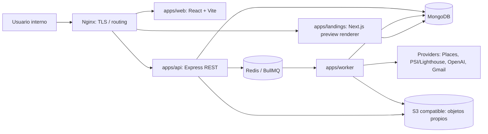

# Nexora — Technical Requirements Document

**Versión:** 1.0 · **Estado:** propuesta para aprobación · **Fecha:** 2026-11-12

## 1. Estado del repositorio y alcance técnico

Inspección del 2026-11-12: monorepo npm workspaces con `apps/web` React 19/Vite 8/TypeScript 7 y `packages/ui`; estilos Tailwind 4, tokens neutrales aún no aprobados, shadcn/Base UI y Motion. No existe API, worker, MongoDB, Redis, Docker, CI ni especificación de producto en los archivos inspeccionados. `apps/web/README.md` registra exclusión de InteraUI y Animate por identificación pendiente y HeroUI condicional. No se afirma que la base existente sea ya una arquitectura completa. El futuro monorepo deberá migrar de manera documentada a pnpm/Turborepo del Master Prompt o confirmar conservar npm; no cambiar package manager durante Fase 0.

## 2. Arquitectura propuesta

Monorepo privado TypeScript con cuatro aplicaciones desplegables y paquetes compartidos. Flujo browser→Nginx→SPA/API; API Express valida sesión, permisos y DTO; MongoDB persiste datos propios; Redis/BullMQ coordina jobs; worker invoca adaptadores de proveedores con egress controlado; landing renderer Next.js publica previews privados bajo origen separado; S3-compatible almacena PDFs/medios con URLs firmadas. Integraciones siempre detrás de interfaces por proveedor.

En Docker Compose: `web`, `api`, `worker`, `landings`, `mongodb`, `redis`, `nginx`; servicios de base/cola solo en red privada en producción. Backups cifrados fuera del host; monitoreo/logs sin secretos. En producción inicial, objetivo de arquitectura monolítica modular con procesos separados, no microservicios distribuidos.

### Versiones y compatibilidad

La base del repositorio inspeccionada para Fase 0 era React/react-dom 19.3.1, Vite 8.3.8, plugin React 6.3.0, TypeScript 7.0.2, Tailwind 4.3.5, shadcn CLI 4.23.0, Base UI 1.9.0, Motion 14.12.0, Inter Variable 5.3.0. Fase 1 migró el workspace a pnpm 12.11.2/Turborepo 2.11.11, instaló el lockfile y fijó los paquetes concretos en `pnpm-lock.yaml`. MongoDB corre como replica set autenticado para soportar transacciones; el keyfile se genera desde `.env` ignorado. Redis requiere contraseña y queda solo en la red privada.

| Tecnología solicitada | Decisión/uso | Compatibilidad y condición |
|---|---|---|
| React | SPA interna y editor | 19.3.1 presente; verificar compatibilidad de cada paquete |
| Vite | bundle/dev de `apps/web` | 8.3.8 presente; Node soportado arriba |
| TypeScript | strict en apps/paquetes | 7.0.2 presente; fijar compilador de servidor compatible |
| Node.js | API/worker/build | **24.22.x LTS**; build verificado con Node 24.22.3. |
| Express | API `/api/v1` | **5.1.x**; Node 24 y TypeScript strict. |
| MongoDB/Mongoose | persistencia documental | **MongoDB 7.0.48** en Docker (release oficial del 2026-11-11); se elige 7.0 por compatibilidad del kernel Linux 6.19 de desarrollo local con TCMalloc de MongoDB 8.0+. Mongoose compatible fijado en lock; replica set para transacciones. Reevaluar 8.0 cuando MongoDB publique una build compatible con este kernel. |
| Redis/BullMQ | colas, locks, límites | **Redis OSS 8.0-alpine** + **BullMQ 6.x**; Redis requiere clave y queda solo en red privada. |
| Next.js | renderer de landing controlado | **16.4.6**, React 19 y TypeScript 7; build optimizado verificado. Aplicación separada. |
| Tailwind CSS | tokens y layout | v4.3.5 presente, plugin Vite instalado |
| shadcn/ui | fuente de primitives | usar componentes Base UI ya configurados; accesibilidad y licencia por componente |
| HeroUI | uso puntual | opcional, solo ante gap demostrable y coherencia React 19 |
| Aceternity UI / Magic UI | adaptaciones premium puntuales | revisar fuente/licencia/accesibilidad y bundle, no importar temas globales |
| Motion | animación React | 14.12.0 presente; única runtime de animación; reduced motion |
| InteraUI / Animate | sin decisión de paquete | nombres ambiguos; verificar oficial, licencia, mantenimiento, compatibilidad; no instalar hasta identificación inequívoca |
| Docker / Compose | dev y prod controlados | Docker Engine compatible y Compose **v2**; fijar versiones/imágenes por digest en release, healthchecks, usuario no-root y secretos externos |
| Nginx | TLS/routing/headers | **1.30.x stable** propuesta; proxy a servicios internos; configurar tamaño/timeouts/CSP/cache |
| pnpm / Turborepo | monorepo | **pnpm 12.11.2 + Turborepo 2.x** propuestos; pnpm 12.11.2 está disponible en el entorno de trabajo. Un solo lockfile/workspace graph |

## 3. Organización de código prevista

`apps/web` (feature modules, router, query cache, formularios); `apps/api` (config, middleware, dominios, controllers/services/repositories/policies/providers); `apps/worker` (colas, processors, scheduler); `apps/landings` (templates y renderer sin código arbitrario). Paquetes: `ui`, `types`, `validation`, `config`, `database`, `email-templates`, `landing-templates`, `security`, `utils`. OpenAPI es contrato público interno; Zod valida entradas y salidas de proveedor. El código de dominio no depende de SDKs de proveedores.

## 4. ADRs

### ADR-001 — MERN + TypeScript modular

**Estado:** propuesto. MongoDB encaja con documentos versionados/hallazgos; Express/Node permite compartir TypeScript y adaptadores; React/Vite aprovecha la base existente. Mantener límites de dominio, índices y contratos para evitar que flexibilidad documental elimine integridad. Next.js solo para render de landings, no segundo frontend administrativo.

### ADR-002 — Monorepo y package manager

**Estado:** aprobado por el propietario el 2026-11-12. El repo migra de npm workspaces a pnpm workspaces + Turborepo para caching y orquestación de apps, conservando el código existente y un único lockfile. Se fija `pnpm@12.11.2` (disponible en el entorno) y línea Turborepo 2.x, con resolución exacta en lockfile. No mantener dos gestores. Aceptación exige build/typecheck reproducibles por workspace.

### ADR-003 — Sesiones

Cookie de sesión opaque, `HttpOnly`, `Secure` en prod, `SameSite=Lax` (evaluar flujo OAuth), ID rotado después de login/MFA/cambio privilegio; session store Redis o Mongo con TTL; CSRF token/origin checks en mutaciones; no JWT durable en localStorage. Recuperación con token aleatorio de un solo uso, hash almacenado y expiración. Argon2id con parámetros calibrados en despliegue. MFA TOTP obligatorio Admin; recovery codes hash.

### ADR-004 — Aislamiento organizativo

Una organización interna inicialmente, `organizationId` obligatorio en datos comerciales y acceso aplicado en repository/policy, no solo filtro UI. Membership relaciona user/org/role. Pruebas negativas de IDOR/BOLA. No onboarding o facturación multiempresa. Recurso global de plantilla se marca explícitamente.

### ADR-005 — Secretos e integraciones

Secretos de runtime vía secret manager/env inyectado, nunca Git o imagen. Tokens de usuario cifrados con envelope/data key fuera de DB; clave raíz administrada fuera de Mongo, rotación versionada. Settings solo revela estado/metadatos. OAuth revocable y scopes mínimos. Cada proveedor expone contrato neutral, límites, provenance, términos/retención y ApiUsage.

### ADR-006 — Procesamiento asíncrono

BullMQ para operaciones lentas/costosas. Job idempotente por clave de operación/recurso/versión; outbox cuando una escritura DB debe disparar job; estados guardados y correlación; backoff limitado; timeout/concurrency/cancel; jobs sensibles (send email) sin retry ciego y con reconciliación de proveedor. DLQ/failed queue con retención acotada.

### ADR-007 — Integración de IA

Proveedor detrás de interfaz, inicialmente OpenAI opcional. Prompt versionado; datos externos tratados como instrucciones no confiables; minimización/redacción; salida JSON schema validada; presupuesto/timeout/token limits; registrar modelo/versión y referencia de insumo según política de retención; humano revisa copy antes de uso. No usar output para mutar hechos ni ejecutar código.

### ADR-008 — Generación de landings

Next.js renderer de templates versionadas; IA genera contenido estructurado, no código. Contenido sanitizado y limitado; imágenes autorizadas/licenciadas; preview noindex, acceso temporal; publicación externa requiere autorización y validación. Separar dominio/origen para limitar cookies y CSP. SSRF de recursos remotos bloqueado.

### ADR-009 — Despliegue

Docker Compose con Nginx y servicios internos, imágenes multi-stage no-root, health/readiness checks, volúmenes y redes separadas. Dev local distinto de prod; prod secretos externos, TLS, backup/restore probado, rollback de imagen/config. Sin despliegue público durante Fase 0. CI privada bloquea merge ante checks críticos.

### ADR-010 — Proveedores de datos

Contratos intercambiables; términos documentados por proveedor/campo/uso/retención antes de activar. Datos Google Places efímeros salvo campos/IDs cuya conservación permite expresamente el contrato vigente. El dominio distingue `BusinessReference` temporal/proveedor de `Lead` de primera parte; solo transferencia permitida mediante fuente compatible. No se depende de scraping ni se evaden límites.

## 5. Seguridad y privacidad

### Modelo de amenazas resumido

Activos: credenciales/sesiones, tokens Gmail/API, leads/contactos, material de cliente, demos y propuestas, costes, auditoría. Actores: usuario interno comprometido, cuenta externa que intenta acceso, proveedor OAuth, contenido web/email hostil, abuso accidental, dependencia comprometida, operador con permisos excesivos. Límites de confianza: navegador→API; API→DB/Redis; worker→Internet; IA/Google/Gmail→sistema; almacenamiento→enlaces compartidos.

| Amenaza | Control de diseño |
|---|---|
| Robo/fijación de sesión, fuerza bruta | Argon2id, MFA Admin, rate limits, rotación, expiración, revocación y auditoría |
| IDOR/aislamiento roto | org-scoped repositories, policy en cada endpoint, deny by default y tests cross-org |
| XSS/inyección HTML/NoSQL | DTO allowlist, schemas, sanitización contextual, operadores Mongo bloqueados, escape de salida, CSP |
| CSRF | cookies SameSite, token/origin checks para mutaciones y OAuth state/PKCE donde aplique |
| SSRF desde auditor/preview | solo HTTP(S), resolver/filtrar IP especial, revalidar redirects/DNS, egress policy, límites y no acceso metadata |
| Exposición OAuth/API keys | secret manager, cifrado en reposo, scopes mínimos, redacción logs, rotación/revocación |
| Prompt injection y salida dañina | contexto no confiable delimitado, sin tools peligrosas, JSON schema, revisión humana, no ejecución |
| Duplicación o reintento de email | aprobación ligada a hash, idempotency/reconciliación, suppression check justo antes de send |
| Filtración en logs/backups | redacción, retención, cifrado, acceso limitado y ejercicios restore |
| Cadena de suministro | lockfile, auditoría de dependencias/licencias, secret scan, imágenes fijadas y actualizaciones revisadas |

### Controles

- AuthN/AuthZ: invitación, Admin/Operator, MFA TOTP Admin, sesiones revocables, control por ruta/acción y último Admin protegido.
- API: rate limits globales y por operación, validación Zod, tamaño máximo, CORS explícito, Helmet, errores sin stack/secretos, paginación limitada, mass assignment imposible.
- Datos: TLS en tránsito; cifrado de discos/backups; cifrar tokens OAuth y secretos de integración; PII minimizada; eliminar por política y no retener contenido restringido de proveedor.
- Auditoría: login, permisos, export, email, OAuth, delete, config crítica; append-only desde la app, retención/acceso restringidos.
- Incidentes: identificar/quitar credencial, revocar sesiones/tokens, preservar logs, evaluar alcance y obligaciones de aviso; restauración a punto acordado. Procedimiento operativo se completará antes de producción.
- Backups: backup cifrado Mongo y objetos con frecuencia/RPO acordados, prueba de restore/RTO antes de lanzamiento; valores objetivo pendientes de capacidad y hosting.

## 6. No funcionales (objetivos, aún no medidos)

| Área | Objetivo inicial verificable |
|---|---|
| Rendimiento web | p75 LCP ≤2.5 s, INP ≤200 ms, CLS ≤0.1 en rutas clave bajo perfil de referencia acordado; no resultado medido |
| API | p95 ≤500 ms para lecturas CRUD comunes excluyendo proveedores/jobs; p95 de consulta paginada ≤750 ms con dataset de referencia |
| Disponibilidad | objetivo operativo inicial 99.5% mensual excluyendo mantenimiento acordado, sujeto a infraestructura; no SLA comercial |
| Escalabilidad | 10 usuarios internos concurrentes y 100k leads de primera parte como prueba objetivo; revisar si cambia el uso |
| Accesibilidad | WCAG 2.2 AA objetivo; teclado, contraste, anuncios y reduced motion en flujos principales |
| Recuperación | objetivo provisional RPO ≤24h/RTO ≤8h para despliegue interno; confirmar con coste/hosting, probar restore |
| Observabilidad | logs JSON correlacionados, métricas HTTP/job/provider y alertas de fallos/cuotas; sin PII ni secretos en logs |
| Seguridad | checklist OWASP ASVS nivel 2 como guía; pentest/assessment antes de exposición amplia |
| Mantenibilidad | strict TS, OpenAPI, schemas compartidos cuando apropiado, ownership modular y lockfile reproducible |
| Coste | presupuesto máximo por proveedor configurable; estimación/preflight y alertas; límites duros para IA/discovery configurables |

Todos son objetivos de diseño; ninguno se declara alcanzado. Costes monetarios y disponibilidad dependen de proveedores/hosting elegidos y aún no se cuantifican. MongoDB publicó que los kernels 6.19–7.0.13 son incompatibles con TCMalloc en su línea 8.0; este host usa kernel 6.19, por eso desarrollo local usa MongoDB 7.0.48. Fuentes oficiales consultadas el 2026-11-13: [Node.js releases](https://nodejs.org/en/about/previous-releases), [Express support](https://expressjs.com/en/support/), [MongoDB 8.0 release notes](https://www.mongodb.com/docs/v8.0/release-notes/8.0/), [MongoDB 7.0.48 release notes](https://www.mongodb.com/docs/v7.0/release-notes/7.0/), [Next.js blog](https://nextjs.org/blog), [Redis Open Source](https://redis.io/docs/latest/operate/oss_and_stack/), [BullMQ changelog](https://docs.bullmq.io/changelog), [Nginx downloads](https://nginx.org/en/download.html). Las versiones propuestas se verifican contra el lockfile, builds y advisories antes de declarar esta fase cerrada.

## 7. Observabilidad, datos y contratos externos

Correlation ID por request/job; Pino redacta Authorization, cookies, tokens, email bodies y API keys; Health/readiness no exponen secretos. ApiUsage contiene proveedor, acción, unidad/coste reportado, moneda, periodo y request ID; costo estimado separado de factura real.

Contratos en Schema/API: Google Places solo campos autorizados y atribución requerida; Gmail OAuth scopes mínimos con revocación y política de datos; OpenAI prompt/modelo configurable y términos de retención revisados; auditoría solo GET acotado/permitido, no explotación; S3 compatible con cifrado, URL firmada, expiración y controles de borrado. Estas integraciones se habilitan individualmente tras credenciales, prueba y revisión de términos vigentes.

## 8. Riesgos técnicos y mitigación

1. Restricciones cambiantes de datos Google → evitar persistencia por defecto y revisar contrato actual por campo antes de habilitar.
2. Outreach regulatorio/reputacional → revisión legal/operativa, consentimiento/base y suppression, envío individual aprobado; campañas automatizadas fuera de MVP.
3. SSRF al analizar URLs → worker aislado con egress controlado, DNS/redirect validation y límites.
4. Mezcla de npm/pnpm y evolución de versiones → única migración aprobada con lockfile y CI.
5. Scope amplio → fases con acceptance y MVP por vertical, no activar módulos antes de auth/data/contracts.
6. Diseño de marca aún no aprobado → conservar tokens actuales como scaffolding; aplicar paleta Master Prompt solo tras confirmar referencia.

## 9. Decisiones confirmadas para Fase 1

El propietario aprobó el 2026-11-12: (1) EE. UU., USD, servicios web locales, roles Admin/Operator y precios editables como alcance inicial; (2) migrar npm workspaces a pnpm + Turborepo; (3) adoptar como dirección visual la paleta/logotipo descritos, aplicando tokens accesibles; (4) operar una organización interna en MVP y preparar aislamiento multi-org. La referencia gráfica final podrá sustituir la dirección del logo mediante actualización documentada.
