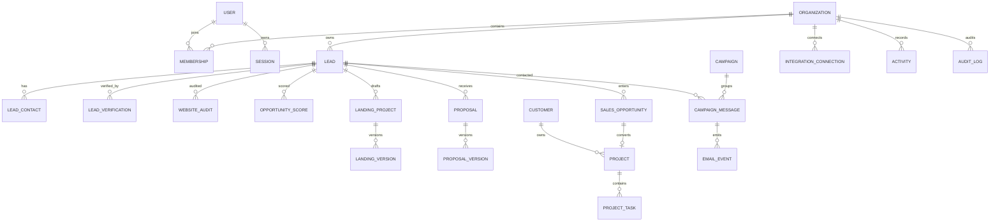

# Nexora — Backend Schema and API Contracts

**Versión:** 1.0 · propuesta para aprobación · 2026-11-12

## 1. Convenciones y protección de datos

MongoDB/Mongoose, UUID/ULID string IDs (elegir una convención única en Fase 1; propuesta UUIDv7), UTC timestamps, `createdAt`/`updatedAt`, optimistic `version`, `organizationId` obligatorio en datos comerciales. Todas las consultas por org se aplican en repository/policy. Campos siguientes son diseño, no modelos implementados.

Convención de borrado: identidad y recursos con historial usan `archivedAt`/`deletedAt` según dominio; secretos/archivos tienen borrado efectivo y revocación; AuditLog append-only con retención definida; referencias temporales de proveedor expiran. `sourceRefs` identifica proveedor, campo, fecha, autorización/retention class; no copiar payload externo sin revisar permiso. PII de contacto minimizada. Timestamps de fuente no sustituyen timestamps del registro.

## 2. Modelos

Tipos comunes: `Id=UUID string`, `Date=UTC`, `Money={amountMinor:int,currency:'USD'}`, `Ref<T>=Id`, `OrgDoc` incluye `_id, organizationId, createdAt, updatedAt, version`. Campos indicados `?` opcionales; campos privados se omiten en serialización.

| Modelo | Propósito, campos y validación | Índices/relaciones, seguridad y eliminación |
|---|---|---|
| User | identidad: email normalizado único global, displayName, passwordHash Argon2id, locale `en/es`, status `invited/active/disabled`, mfa `{enabled,secretCiphertext,recoveryCodeHashes}`, lastLoginAt | índice unique email; no devolver hash/secret; baja conserva referencia auditada, anonimización según política |
| Organization | tenant interno: name, slug, status, defaultLocale, timezone, currency `USD`, settingsRef | slug unique; retención/ajustes; soft archive; no onboarding público |
| Membership | userId, organizationId, role `admin/operator`, status `invited/active/suspended`, invitation `{tokenHash,expiresAt,acceptedAt}`, invitedBy | unique `(organizationId,userId)`; token one-use hash; último Admin protegido; revocación |
| Session | userId, organizationId, tokenHash, csrfHash, createdAt, lastSeenAt, expiresAt, revokedAt, ipHash?, userAgentSummary? | tokenHash unique, TTL expiresAt; jamás valor cookie; borrar al vencer/revocar |
| IntegrationConnection | organizationId, provider `google_places/gmail/openai/pagespeed/s3/smtp`, accountLabel, scopes, status, credentialCiphertext/keyVersion, connectedBy, checkedAt, revokedAt | unique org/provider/account; secretos cifrados y excluidos DTO/log; revocar y borrar ciphertext |
| BusinessReference | observación/candidato de fuente: provider, providerId?, sourceRefs, businessName, category?, location?, websiteDeclared?, fetchedAt, expiresAt, rawPayload? (solo si contract permite) | índice `(org,provider,providerId)` parcial; TTL para snapshots permitidos; datos Google temporales salvo permiso explícito |
| Lead | first-party CRM record: name, category?, address `{city,state,postalCode,country}`, website?, websiteStatus enum, ownerId?, lifecycle `active/archived`, stage ref, scoreRef?, tags[], notesSummary?, sourceRefs[], customerId? | índices org+name, org+city+category, org+stage+updatedAt; dedupe con clave normalizada y resolución humana; archivar, borrar bajo política |
| LeadContact | leadId, type `email/phone/form/social`, value, normalizedValue, sourceRef, verifiedAt?, status `unverified/verified/invalid/suppressed`, isCommercial, notes? | org+normalizedValue; no adivinar; PII acceso según rol; borrar/suprimir sujeto a obligaciones |
| LeadVerification | leadId, method, websiteStatus enum, evidence[] `{kind,value,sourceRef,observedAt}`, confidence `low/medium/high`, reviewerId?, reviewedAt?, status, errorCode? | org+lead+createdAt; evidencia fechada; eliminar evidencia externa al expirar permiso |
| WebsiteAudit | leadId?, normalizedUrl, status `pending/processing/completed/failed/cancelled`, requestedBy, startedAt?, completedAt?, checks[] `{key,status,value?,evidenceRef?,severity?}`, scores? (fuente lab/RUM), limitations[], policyVersion, reportObjectKey? | org+lead+createdAt; URL validated; resultado solo diagnóstico permitido; PDF own data con TTL de objeto |
| OpportunityScore | leadId, score 0..100, confidence, factors[] `{key,weight,value,points,evidenceRefs[]}`, rulesVersion, modelInfo?, recommendation?, calculatedAt | org+lead+rulesVersion+calculatedAt; score versionado; inferencia etiquetada |
| Campaign | nombre, status `draft/active/paused/completed/archived`, audienceFilter, createdBy, schedule?, policyVersion | org+status; MVP no bulk auto-send; pausar/cancelar auditable |
| CampaignMessage | campaignId?, leadId, contactId, channel `gmail`, recipientHash, subject, bodyEncrypted/retention policy, contentHash, status `draft/approved/queued/sending/sent/replied/failed/bounced/unsubscribed/uncertain`, approvedBy/At, providerMessageId?, sentAt?, idempotencyKey | org+lead+createdAt, unique idempotency; contenido sensible cifrado y borrable; envío exige supresión check |
| EmailEvent | messageId, eventType `sent/reply/bounce/unsubscribe/failure`, occurredAt, providerEventId?, evidenceRef, verified | unique providerEventId parcial; solo eventos confirmados; retención mínima necesaria |
| SuppressionEntry | normalizedAddressHash, reason, source `unsubscribe/manual/bounce`, createdAt, expiresAt? | unique org+addressHash; check antes de cada envío; conservar mínimo necesario y no usar para outreach |
| LandingProject | leadId, name, templateId/version, status `draft/generating/review/preview/approved/published/archived/failed`, previewTokenHash?, expiresAt?, publishedUrl?, approvedBy/At? | org+lead+updatedAt; preview token hash y TTL; noindex, archivar/borrar según contrato |
| LandingVersion | landingProjectId, sequence, structuredContent, themeTokens, sectionOrder, dataProvenance, promptVersion?, modelInfo?, createdBy, createdAt | unique `(org,landingProjectId,sequence)`; schema estructurado, sanitizar contenido, no HTML/code ejecutable; conservar versiones según policy |
| Proposal | leadId, customerId?, status `draft/review/sent/accepted/rejected/expired/archived`, currency, validUntil?, currentVersion, sentAt?, acceptedAt? | org+lead+status; aceptación con evidencia/actor; soft archive |
| ProposalVersion | proposalId, sequence, items[] `{serviceId,label,quantity,unitAmountMinor}`, costsMinor, totalMinor, marginBasisPoints?, timeline, terms, pdfObjectKey?, contentHash | unique `(org,proposalId,sequence)`; validar cálculo; PDF firmado/temporal, nunca modificar versión existente |
| SalesOpportunity | leadId, stage enum, valueMinor?, currency, ownerId?, expectedCloseAt?, lossReason?, nextActionAt? | unique org+lead para pipeline primario (revisar múltiples oportunidades en futuro); org+stage+owner+updatedAt; transiciones auditadas |
| Customer | leadId?, businessName, billing/contact fields mínimos, status, sourceRefs | org+businessName; datos financieros restringidos; eliminar/anonimizar por política y obligaciones |
| Project | opportunityId?, proposalId?, customerId, name, status enum, ownerId?, startAt?, dueAt?, approvedScopeVersion?, previewUrl?, publishedUrl?, completedAt? | org+status+dueAt; unique opportunityId para conversión idempotente; soft archive; publicar requiere auth |
| ProjectTask | projectId, title, description?, status `todo/doing/blocked/done`, assigneeId?, dueAt?, sortKey, checklist[] | org+project+status+sortKey; soft delete/audit; archivos en Object storage |
| Activity | subjectType/id, actorId?, kind, summary, occurredAt, metadataAllowlist, sourceRef? | org+subject+occurredAt; metadata no secrets; append-only desde app, retención política |
| Notification | userId, type, titleKey, resourceRef?, readAt?, createdAt | org+user+readAt+createdAt; no PII innecesaria; TTL/limpieza configurable |
| ApiUsage | provider, operation, requestId, jobId?, units, costMinor?, currency?, status, occurredAt, pricingVersion? | org+provider+occurredAt; coste reportado vs estimado; no request payload/secrets |
| AuditLog | actorId?, action, resourceType/id?, occurredAt, requestId, outcome, redactedMetadata, ipHash? | org+occurredAt+action; append-only, acceso Admin; retención/inmutabilidad de almacenamiento por decidir |
| AppSetting | scope `org/user/system`, key, valueSchemaVersion, value, updatedBy | unique scope+owner+key; allowlist schemas; nunca guardar secret en claro (secrets en integration vault) |

`LeadSource`, `LandingTemplate`, `ProjectDocument` del Master Prompt se modelan como `sourceRefs`, catálogo controlado y metadatos/object storage con ACL en MVP; colecciones independientes solo si requisitos de volumen/consulta lo justifican. `ApiUsage` no es crédito comercial.

## 3. Relaciones

## 4. API REST `/api/v1`

JSON over HTTPS. Cookie session for browser; CSRF token/origin check on mutation. OAuth callbacks are state-bound. Standard error `{error:{code,message,fieldErrors?,requestId}}`; never stack/secret. Collections `{data, page:{cursor?,limit,hasMore}, requestId}`; limit default 25/max 100; stable cursor sort with `_id` tiebreaker. Filters allowlisted, sort allowlisted, dates ISO UTC. DTOs explicitly map fields; reject protected fields and mass assignment. OpenAPI is source of contract.

| Grupo | Métodos y endpoints principales | DTO/validación y permisos |
|---|---|---|
| auth | POST `/auth/login`, `/auth/mfa/verify`, `/auth/logout`, `/auth/password/forgot`, `/auth/password/reset`; GET `/auth/me` | email/password/TOTP; unauth for login/reset, session otherwise; rate limited |
| users/org | GET/POST `/users`, PATCH `/users/:id`, POST `/users/:id/revoke-sessions`, GET `/organizations/current` | Admin invites/role; membership-scoped; no secret/hash |
| integrations | GET/POST `/integrations/:provider/connect`, GET/DELETE `/integrations/:id` | Admin; OAuth state/PKCE; response status/scopes only |
| discovery | POST `/discovery/searches`, GET `/discovery/searches/:id`, POST `/.../:id/cancel`, GET `/businesses/references` | `DiscoveryQuery` schema country/state/city/category/radius/page; provider-conditioned, quota bounded |
| leads | GET/POST `/leads`, GET/PATCH/DELETE `/leads/:id`, POST `/leads/:id/archive`, `/restore`, GET `/leads/:id/activity` | `LeadCreate/Update`; org policy; optimistic version and duplicate check |
| verification | POST `/leads/:id/verifications`, GET `/verifications/:id`, POST `/.../:id/review` | URL/evidence DTO; review role; state machine |
| audits | POST `/audits`, GET `/audits/:id`, POST `/audits/:id/cancel`, GET `/audits/:id/report` | normalized URL + consent/authority attestation; SSRF policy; export auth |
| intelligence | POST `/leads/:id/scores`, GET `/leads/:id/scores` | rulesVersion/config; score provenance |
| landings | POST/GET `/leads/:id/landings`, GET/PATCH `/landings/:id`, POST `/.../generate`, `/versions`, `/preview`, `/approve`, `/publish` | structured sections schema; org/lead policy; publish separately authorized |
| proposals | POST/GET `/leads/:id/proposals`, GET/PATCH `/proposals/:id`, POST `/.../versions`, `/pdf`, `/send-record`, `/acceptance` | item/price/terms DTO; immutable versions; acceptance evidence |
| outreach | POST `/campaigns`, GET/PATCH `/campaigns/:id`, POST `/messages`, `/messages/:id/approve`, `/send`, `/cancel`; POST `/suppressions` | Admin approve/send; exact content hash; suppression check; idempotency key |
| CRM | GET `/opportunities`, POST `/leads/:id/opportunities`, PATCH `/opportunities/:id/stage`, `/opportunities/:id` | transition schema + role + expected version; Won requires acceptance |
| projects | GET/POST `/projects`, GET/PATCH `/projects/:id`, POST `/.../tasks`, `/convert` | project state, task schema; conversion idempotent |
| analytics | GET `/analytics/summary`, `/funnel`, `/trends`, `/costs` | period/filter allowlists; Admin detail, Operator reduced aggregate |
| settings | GET/PATCH `/settings`, GET/POST `/notifications`, GET `/audit-logs` | scope policy, allowlisted schema; logs read-only |

### Request/response examples

`POST /discovery/searches` request: `{provider:'google_places', query:{country:'US',state:'NY',city:'Albany',category:'cleaning',radiusMeters:10000}, idempotencyKey:'...'}`. Response `202 {data:{jobId,status:'pending',provider,estimatedUnits?},requestId}`. Provider response must use `BusinessReferenceDTO` with only contract-permitted fields.

`POST /leads` request: `{businessName,category?,location,website?,contacts?,sourceRefs,organizationId?}`; organizationId is inferred from session and client-supplied value rejected/ignored. Response 201 returns public `LeadDTO` without private internal fields.

`POST /messages/:id/send` requires `{approvedContentHash,idempotencyKey}`; 202 may mean queued, not delivered. Definitive provider acceptance creates Sent event; ambiguous timeout marks uncertain for reconciliation.

## 5. Códigos de error

400 `VALIDATION_ERROR`; 401 `UNAUTHENTICATED`; 403 `FORBIDDEN`; 404 `NOT_FOUND` (also hides cross-org resources); 409 `CONFLICT`/`DUPLICATE`/`STALE_VERSION`; 413 `PAYLOAD_TOO_LARGE`; 422 `INVALID_TRANSITION`/`POLICY_BLOCKED`; 429 `RATE_LIMITED`/`QUOTA_EXCEEDED`; 502 `PROVIDER_ERROR`; 503 `INTEGRATION_UNAVAILABLE`; 504 `PROVIDER_TIMEOUT`. All include requestId. Field errors contain safe field names only.

## 6. Jobs BullMQ

Defaults proposed, tune after provider limits. Payloads store IDs/config snapshot, not credentials or bulky external payload.

| Job / queue | Payload | Priority / retry / timeout | Idempotencia y resultado |
|---|---|---|---|
| DiscoveryJob / discovery | orgId, queryRef, provider, requestId | normal; 2 retries exp 10s; 90s | query hash + provider; page refs, usage, partial/error |
| VerificationJob / verification | orgId, leadId/refId, method | normal; 2 retries; 60s | lead+method+source version; verification ID/evidence |
| WebsiteAuditJob / audits | orgId, auditId, URL policy snapshot | low; 1 retry only transient; 180s | auditId+policy version; audit result, SSRF deny terminal |
| OpportunityScoringJob / scoring | orgId, leadId, rulesVersion | normal; 2 retries; 30s | lead+rulesVersion+data version; immutable score |
| LandingGenerationJob / ai | orgId, landingId, leadVersion, templateVersion, promptVersion | low; 1 retry if provider transient; 120s | landing+input hash; structured version or failure; budget bound |
| ProposalGenerationJob / documents | orgId, proposalId, version | low; 2 retries; 60s | proposal version; PDF object key/hash |
| EmailDraftJob / ai | orgId, messageId, facts version, promptVersion | low; 1 retry; 60s | message+input hash; draft only |
| AuthorizedEmailSendJob / send | orgId, messageId, contentHash, idempotencyKey | highest; no blind retry; 60s | provider idempotency/reconcile; sent/uncertain/fail |
| AnalyticsAggregationJob / analytics | orgId, window, dimensions | low; 3 retries exp; 120s | org+window+version; aggregate snapshot |
| CleanupJob / maintenance | scope, cutoff, policy version | lowest; 3 retries; bounded batch | scope+cutoff; deleted counts, audit record |

All jobs store `pending/processing/completed/failed/cancelled`, attempts, timestamps, correlation ID, safe error code. Queue defaults require bounded concurrency, provider-specific rate limits, dead-letter inspection and retention/cleanup. No automatic retry of uncertain send.

## 7. Integrations

- **Google Places:** `BusinessDiscoveryProvider.search(query,cursor)` returns normalized transient refs, source attribution and permitted provider IDs/fields. Cost/quota and retention rules are versioned/configured; no scraping. Confirm current Google terms/storage rules before implementation/use.
- **Gmail:** OAuth Authorization Code + state; PKCE where supported/required; minimum scopes; encrypted refresh token; create draft then send only approved exact content; webhook/history synchronization only if allowed and operationally configured; revoke/disconnect deletes token. Apply CAN-SPAM review, suppression and rate constraints.
- **OpenAI:** `TextGenerationProvider.generate(schema, promptVersion, boundedContext)`; no provider SDK in domain; validate structured output; timeout/token/cost limits and data minimization; no training/retention assumptions until contract/account configured.
- **Audit:** `WebsiteAuditProvider.audit(url, policy)` behind isolated worker; manual HTTP checks + official PSI when configured; allowlist checks, SSRF-resistant fetch, no intrusive scans.
- **Storage:** `ObjectStorage.put/getSignedUrl/delete`, server-side encryption, MIME/size validation, random keys, expiry, ACL; never public bucket by default.

## 8. Retención, exportación y borrado

1. **First-party:** leads, proposals, project records retained while operationally needed; archive first, deletion/PII anonymization by Admin policy and legal obligations; audit references may remain redacted.
2. **Provider data:** isolate under BusinessReference/sourceRefs; classify per provider/field; default ephemeral with expiry; retain IDs/fields only if current terms expressly allow; transfer to Lead only when compatible and provenance preserved.
3. **Temporary:** OAuth state, login/reset tokens, preview links, job scratch, audit fetch artifacts and generated exports receive TTL; delete objects and references on expiry/revocation.
4. **Email:** keep minimum status/content needed for operation/compliance, encrypt content, suppressions retain minimum hashed identifier needed to honor opt-out; define exact legal retention with owner before activation.
5. **Backups:** encrypted, restricted and expire on schedule; deletion propagation documented, backups age out; restore must reapply tombstones/policy where feasible.

Retention duration, legal basis for contacts and deletion exceptions are unresolved operational/legal inputs. Product prevents provider data from being treated as unrestricted by default.
