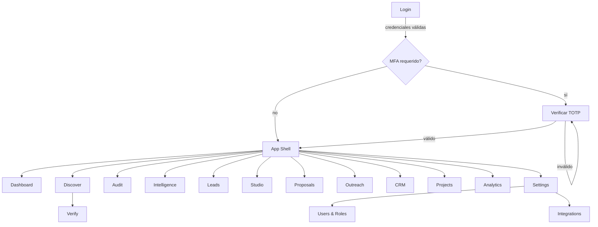
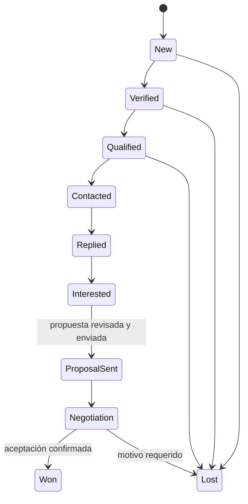
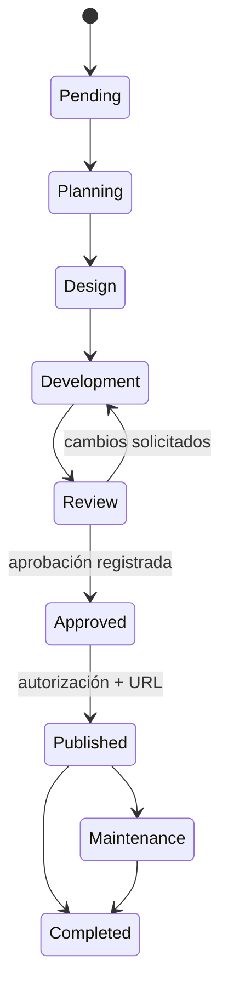
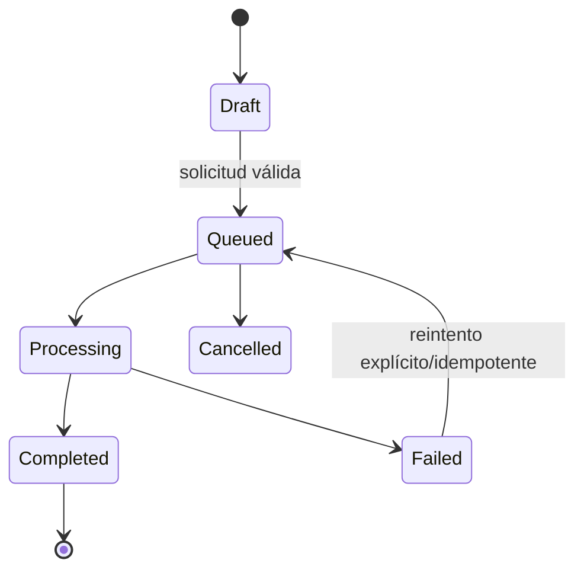
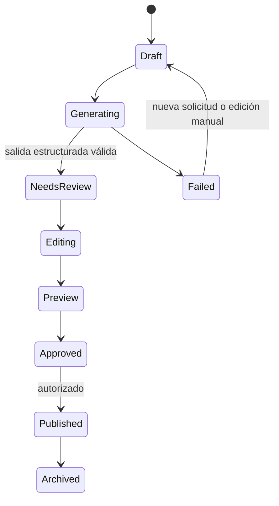

# Nexora — App Flow

**Versión:** 1.0 · propuesta para aprobación · 2026-11-12

## 1. Navegación y acceso

Rutas privadas propuestas: `/login`, `/mfa`, `/dashboard`, `/discover`, `/audit`, `/intelligence`, `/leads`, `/leads/:id`, `/studio`, `/proposals`, `/outreach`, `/crm`, `/projects`, `/analytics`, `/settings`, `/settings/users`, `/settings/integrations`, `/settings/audit-log`. La API sirve los datos; la UI no simula resultados. Login e invitación son públicos solo para completar autenticación, no existe registro público. Usuario sin sesión va a Login; MFA requerido va a MFA; sesión expirada conserva destino seguro y, tras reautenticación, regresa; rol insuficiente recibe Forbidden.

Sidebar escritorio colapsable y navegación móvil en drawer; header con breadcrumbs, búsqueda contextual, idioma, tema, centro de notificaciones y perfil. Cada ruta permite volver al detalle/contexto y conserva filtros seguros en URL.

## 2. Flujos principales

### A — Descubrimiento

1. Usuario abre Discover y elige ubicación/categoría/radio; UI valida límites y muestra coste/cuota conocida.
2. API crea job con filtro, proveedor y `organizationId`; no inserta payload de proveedor si su contrato no lo autoriza.
3. UI muestra Pending→Processing; al completar, resultados paginados indican fuente, fecha y restricciones de almacenamiento.
4. Usuario selecciona negocio; solicita Verify. Vacío de website se etiqueta uncertain hasta evidencia.
5. Revisa evidencias, confirma manualmente y califica con score versionado.
6. Acción Create lead transfiere solo campos con fuente/uso permitidos, detecta duplicado y muestra resultado/conflicto.

### B — Auditoría

1. Desde lead o Audit ingresa URL; API normaliza y valida esquema/dominio.
2. Worker comprueba DNS/IP, redirects y política SSRF antes de cada request; rechaza host interno.
3. Se encola job con límites, fecha y autorización; UI ofrece cancelar si aún es cancelable.
4. Worker analiza pruebas permitidas y opcionalmente llama PageSpeed; guarda versión y evidencias propias permitidas.
5. UI presenta Processing→Completed o Failed, separa no disponible de hallazgo y permite revisión.
6. Usuario genera informe/PDF de la versión; actividad queda en lead.

### C — Landing con IA

1. En lead elige Studio y una plantilla disponible.
2. Revisa datos de negocio marcados verified/unverified; selecciona qué incluir.
3. Envía solicitud estructurada al job IA con presupuesto/timeout; si no hay credencial, informa configuración pendiente.
4. Worker valida JSON con schema y marca campos sin fuente como placeholder; jamás produce código ejecutable.
5. Editor permite texto, secciones, tema y CTA; autosave crea versión recuperable.
6. Preview desktop/tablet/mobile usa renderer controlado, `noindex` y acceso privado/temporal.
7. Estado Draft→Preview→Approved; publicar externo requiere autorización y contenido validado.

### D — Propuesta

1. Desde lead selecciona servicios/paquete y moneda USD.
2. Formulario valida cantidades, alcance, fechas, costes, margen y condiciones.
3. API calcula total de forma reproducible, guarda versión Draft y renderiza preview/PDF.
4. Usuario revisa; editar crea nueva versión. La exportación no equivale a aceptación ni envío.
5. Registro de envío/aceptación solo se crea por acción o evidencia recibida.

### E — Contacto comercial

1. Desde lead elige contacto comercial con fuente y verificación reciente.
2. Redacta o solicita borrador a IA usando hechos permitidos; preview muestra idioma, remitente, destinatario y contenido.
3. Se comprueban supresión, identidad/dirección, asunto, baja y autorización.
4. Admin autorizado aprueba la versión exacta (hash destinatario+contenido+adjuntos).
5. Justo antes del envío API vuelve a comprobar permiso, conexión y lista de supresión.
6. Gmail devuelve estado; resultado incierto requiere reconciliación, jamás reintento automático a ciegas.
7. Replies/bounces/unsubscribe se registran solo con señal verificable y actualizan Activity/CRM.

### F — Conversión

1. Respuesta/interés mueve oportunidad a Interested/Proposal Sent/Negotiation; transición y actor quedan registrados.
2. Usuario registra importe/condiciones y aceptación comprobable.
3. Al seleccionar Won, API valida propuesta aceptada y crea Customer/Project idempotente.
4. CRM queda enlazado al proyecto; etapa no se pierde.

### G — Entrega

1. Crear proyecto a partir de alcance aprobado o manualmente con permiso.
2. Definir responsable, tareas, fechas y checklist.
3. Registrar material/documentos con validación de tipo/tamaño y acceso restringido.
4. Avanzar Pending→Planning→Design→Development→Review.
5. Capturar feedback/revisión y repetir Review según proceda.
6. Approved requiere aprobación registrada; Published requiere autorización y URL verificada.
7. Registrar costes/ingresos y completar; mantenimiento futuro se registra como servicio contractual del cliente.

### H — Administración

1. Admin inicia sesión, verifica MFA y entra al panel.
2. Invita usuario a dirección, selecciona rol y expiración; invitación de un uso.
3. Usuario acepta y define contraseña; no hay signup público.
4. Admin revisa permisos, estado y sesiones; revoca o cambia rol.
5. Integraciones se conectan con OAuth/scopes mínimos; secretos nunca vuelven en claro.
6. Log de auditoría permite filtro/consulta, no editar ni borrar desde UI.

## 3. Estados de interfaz

| Estado | Comportamiento |
|---|---|
| Loading | Skeleton con estructura equivalente; conservar filtros; anunciar carga si esperada |
| Empty | Explicar por qué no hay elementos y ofrecer acción de inicio; sin cifras inventadas |
| Success | Confirmar acción y siguiente paso; mostrar fuente/fecha si hay datos externos |
| Error | Mensaje legible, código de correlación y retry solo si idempotente |
| Unauthorized | Sesión ausente/expirada: Login; volver a destino tras autenticación segura |
| Forbidden | Acceso denegado sin revelar existencia de recursos; camino de retorno |
| Expired | Invitar a reconectar/reautenticar; descartar token en UI y preservar borrador seguro |
| Pending | Aceptado por sistema pero aún sin ejecución; estado consultable y opción cancelar |
| Processing | Progreso real si existe; nunca porcentaje inventado; cancelación acotada |
| Completed | Resultado y timestamp; ofrece revisión/continuación |
| Failed | Error clasificado, reintento controlado o soporte; mantiene evidencia parcial permitida |

## 4. Diagramas de estados

## 5. Permisos de navegación

| Área | Admin | Operator |
|---|---|---|
| Dashboard/Discover/Audit/Intelligence/Leads/Studio/Proposals/CRM/Projects | lectura/escritura según acción | lectura/escritura comercial según policy |
| Envío de mensajes | aprobar/enviar | redactar y solicitar aprobación |
| Analytics detallado/costes | sí | agregado permitido; no configuración financiera crítica |
| Settings perfil/idioma/tema | sí | preferencias propias |
| Integrations/secrets/users/roles/audit logs | sí | no |

La UI oculta acciones no autorizadas para claridad; la API vuelve a validar cada llamada.
